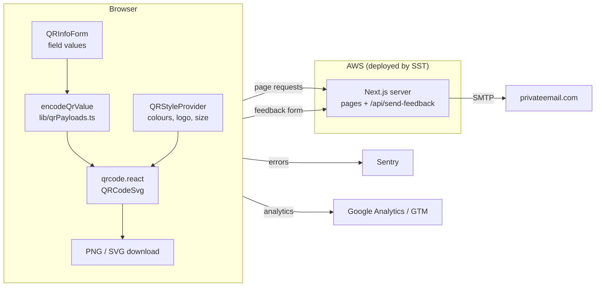

# Architecture

Free QR Gen is a Next.js App Router site that generates QR codes **entirely in the browser**. The server renders pages and handles one API route (feedback email). It never sees or stores what people put into their QR codes.

## Overview



## Tech stack

| Area           | Choice                                                                                         |
| -------------- | ---------------------------------------------------------------------------------------------- |
| Framework      | Next.js 16 (App Router), React 19, React Compiler                                              |
| Language       | TypeScript                                                                                     |
| Styling        | Tailwind CSS 3, with shared classes (`card`, `input`, `field-label`…) in `src/app/globals.css` |
| QR rendering   | [`qrcode.react`](https://github.com/zpao/qrcode.react) (`QRCodeSVG`)                           |
| Hosting        | AWS via [SST](https://sst.dev) (`sst.aws.Nextjs`), region `us-east-1`                          |
| Error tracking | Sentry (client side; server side is currently disabled, see [tech debt](tech-debt.md))         |
| Analytics      | Google Analytics + Google Tag Manager (`src/app/Providers.tsx`)                                |
| Email          | `nodemailer` over SMTP for the feedback form                                                   |
| Tests          | Vitest + Testing Library unit tests, Playwright end-to-end tests ([testing](testing.md))       |

`next.config.ts` turns on `reactCompiler`, `cacheComponents` and `partialPrefetching`. These change how rendering, caching and `<Link>` prefetching behave compared with older Next.js versions. Read the bundled docs in `node_modules/next/dist/docs/` before changing them (see the note in [`AGENTS.md`](../AGENTS.md)).

## Directory layout

```
src/
  app/
    page.tsx                  Home page = the URL QR generator
    <type>-qr-code-generator/ One route per other QR type (thin wrappers around ToolPage)
    <guide-slug>/             One route per guide/article (mostly wrappers around GuidePage)
    guides/                   Guides hub, grouped by QR type
    about/                    About page
    api/send-feedback/        Feedback email route handler
    components/               UI components (see below)
    components/form/          The generator form and its inputs
    lib/                      Data and pure logic: QR types, encoders, guides, metadata
    constants/constants.ts    Site URL, regexes, size presets, limits
    types.ts                  Shared types (QrType, prop interfaces)
    sitemap.ts, robots.ts, manifest.ts
  instrumentation*.ts         Sentry hooks
tests/e2e/                    Playwright tests
public/                       Static assets; guide images in public/guides/<guide>/
sst.config.ts                 Infrastructure (domain, env vars, IAM permissions)
```

## The QR code generator

Data-driven: every QR type is described once and the UI, routing, footer, sitemap and tests all read from that description.

1. **`src/app/types.ts`** defines the `QrType` union (`'url' | 'wifi' | 'vcard' | …`).
2. **`src/app/lib/qrTypes.ts`** maps each type to a `QrTypeConfig`: its route `path`, tab label and icon, download filename, default values, and its form `fields` (with optional `validate` and `showIf`).
3. **`src/app/lib/qrPayloads.ts`** has one encoder per type that turns the form values into the string stored in the code (for example `WIFI:T:WPA;S:…;;`, a vCard 3.0 block, `mailto:`, `https://wa.me/…`). An encoder returns `null` until the required fields are present and valid, which keeps the preview empty.
4. **`QRInfoForm`** (`components/form/QRInfoForm.tsx`) holds the field values, calls `encodeQrValue`, and shows warnings (low colour contrast, logo with low error correction, very long content).
5. **`QRContentFields`** renders the fields from the config. Validation messages appear only after the user leaves a field.
6. **`QRPreview`** renders `QRCodeSvg` and handles downloads. SVG downloads serialise the rendered `<svg>`. PNG downloads draw that SVG onto a `<canvas>` at the chosen size.

### Shared style state

`QRStyleProvider` lives in the root layout (via `Providers.tsx`), so size, colours, logo and error-correction level carry over when someone switches between QR types. Uploaded logos are read with `FileReader` into a data URL and never uploaded anywhere.

### Why everything is client side

Codes are **static**: the content goes straight into the code, with no redirect service. That means codes never expire, and sensitive values like WiFi passwords never leave the device. The site's copy promises both, so keep them true. See [ADR 0001](adr/0001-static-client-side-qr-codes.md).

## Pages

There are three kinds of content page:

| Kind            | Built with                               | Content lives in                                         |
| --------------- | ---------------------------------------- | -------------------------------------------------------- |
| Home (URL tool) | `page.tsx`, `HomeInfo`, `JsonLd`         | Components directly                                      |
| Tool pages      | `components/ToolPage.tsx`                | `lib/toolPageContent.ts` (steps, sections, FAQs)         |
| Guides          | `components/GuidePage.tsx` (most guides) | The guide's `page.tsx` plus its entry in `lib/guides.ts` |

The QR type tabs (`QRTypeTabs`) are real links to separate routes, not client-side tabs, so each type has its own crawlable page. See [ADR 0002](adr/0002-one-route-per-qr-type.md).

`ToolPage` automatically links to every guide whose `types` list includes that tool's type, so adding a guide to `lib/guides.ts` updates the tool pages and the guides hub.

## API

### `POST /api/send-feedback`

Used by the footer's `FeedbackForm`.

- **Body:** `{ "feedback": string }`
- **Does:** sends the feedback as an email to `dev@aidanlowson.com` through `mail.privateemail.com` (SMTP, port 465), using `EMAIL_PASSWORD`.
- **Returns:** `{ "message": string }`. It returns HTTP 200 even when sending fails, so check the message text. See [tech debt](tech-debt.md).

The same handler is also exported as `GET`.

## External services

| Service                                | Used for                         | Configured in                                                     |
| -------------------------------------- | -------------------------------- | ----------------------------------------------------------------- |
| AWS (via SST)                          | Hosting, CDN, DNS (Route 53)     | `sst.config.ts`, GitHub Actions secrets                           |
| privateemail.com                       | Sending feedback emails          | `src/app/api/send-feedback/route.ts`, `EMAIL_PASSWORD`            |
| Sentry (`processvision/free-qr-gen`)   | Error and performance monitoring | `next.config.ts`, `src/instrumentation*.ts`, `sentry.*.config.ts` |
| Google Analytics / GTM                 | Analytics                        | `src/app/Providers.tsx`                                           |
| Google Search Console / Bing Webmaster | Site verification                | `verification` in `src/app/layout.tsx`                            |
