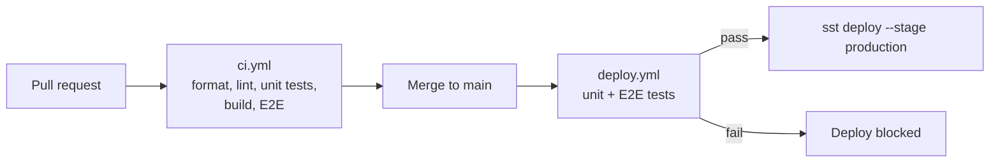

# Deployment

Production is https://freeqrgen.net, on AWS, deployed with [SST](https://sst.dev) v4. There is one stage, `production`.

## How a change reaches production



1. **`.github/workflows/ci.yml`** (job "Lint, test & build") runs on every PR and push to `main`: `pnpm install --frozen-lockfile`, `pnpm format:check`, `pnpm lint`, `pnpm typecheck`, `pnpm test`, `pnpm build`, `pnpm test:e2e`.
2. **`.github/workflows/deploy.yml`** runs on every push to `main`, in the `production` GitHub environment:
   1. installs dependencies with a frozen lockfile, using the same pnpm version as CI,
   2. runs the unit tests,
   3. runs the Playwright E2E tests,
   4. configures AWS credentials,
   5. runs `npx sst deploy --stage production --yes`.

`main` is protected by the "Protect Main" ruleset on GitHub: changes go through a pull request, and force-pushes and deletion are blocked.

Every merge to `main` deploys. There is no separate release step.

## Infrastructure (`sst.config.ts`)

- **App:** `free-qr-gen`, region `us-east-1`. Production resources use `removal: 'retain'`, so they survive a `sst remove`.
- **`sst.aws.Nextjs('MyWeb')`** builds the Next.js app with OpenNext and deploys it to AWS (CloudFront, Lambda, S3).
- **Domain:** `freeqrgen.net`, with `www.freeqrgen.net` redirecting to it. DNS is in Route 53, and `override: true` lets SST replace existing records.
- **Runtime environment:** `BASE_URL`, `EMAIL_PASSWORD`, `HOSTED_ZONE_ID`, `NEXT_PUBLIC_SENTRY_DNS`, `SENTRY_DNS`, `NODE_ENV=production`.
- **IAM:** read/write access to the `NewsLetterSubscribers` DynamoDB table. Nothing uses it at the moment, see [tech debt](tech-debt.md).

## Secrets

Stored as GitHub Actions secrets on the `production` environment:

| Secret                                                     | Used for                                                              |
| ---------------------------------------------------------- | --------------------------------------------------------------------- |
| `AWS_ACCESS_KEY_ID`, `AWS_SECRET_ACCESS_KEY`, `AWS_REGION` | SST deploy                                                            |
| `HOSTED_ZONE_ID`                                           | Route 53 zone for the domain                                          |
| `EMAIL_PASSWORD`                                           | Feedback email SMTP login                                             |
| `SENTRY_DNS`                                               | Sentry DSN (passed as both `SENTRY_DNS` and `NEXT_PUBLIC_SENTRY_DNS`) |
| `SENTRY_AUTH_TOKEN`                                        | Uploading source maps to Sentry at build time                         |

To add a new runtime variable: add the secret in GitHub, pass it in the `env` of the deploy step in `deploy.yml`, and add it to `environment` in `sst.config.ts`.

## Deploying by hand

Avoid this if you can, because it skips the E2E gate. If you need to:

```bash
export AWS_ACCESS_KEY_ID=… AWS_SECRET_ACCESS_KEY=… AWS_REGION=us-east-1
export HOSTED_ZONE_ID=… EMAIL_PASSWORD=… SENTRY_DNS=… NEXT_PUBLIC_SENTRY_DNS=… SENTRY_AUTH_TOKEN=…
pnpm deploy
```

`pnpm refresh` (`sst refresh --stage production`) brings SST's state back in line with what is actually in AWS, for example after a resource was changed in the console.

## Rolling back

There is no automated rollback. Revert the bad commit on `main` and the deploy workflow ships the previous code again.

## After deploying

- Check the site loads and generates a code.
- Check Sentry for new errors.
- If page URLs changed, resubmit the sitemap (`/sitemap.xml`) in Google Search Console.
